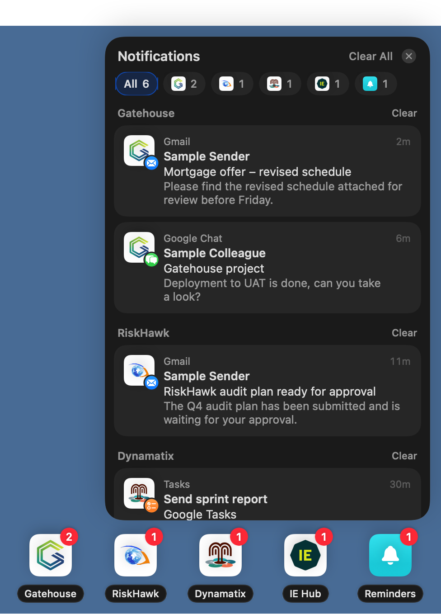
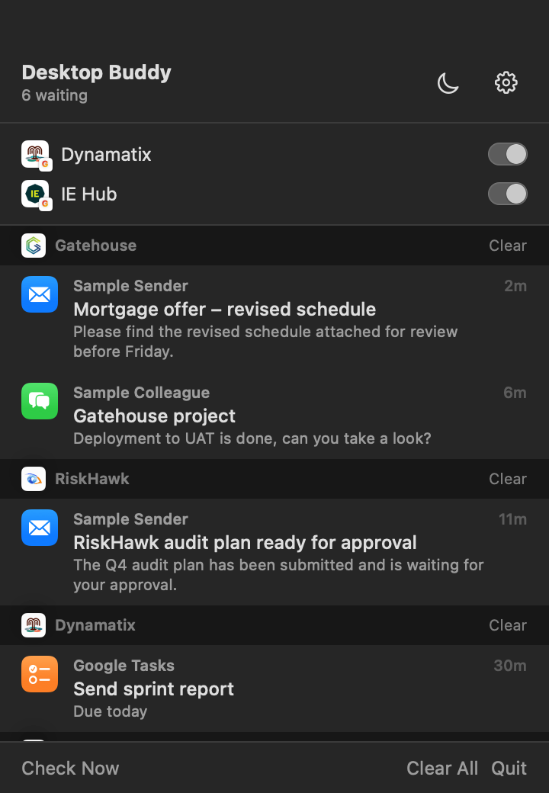
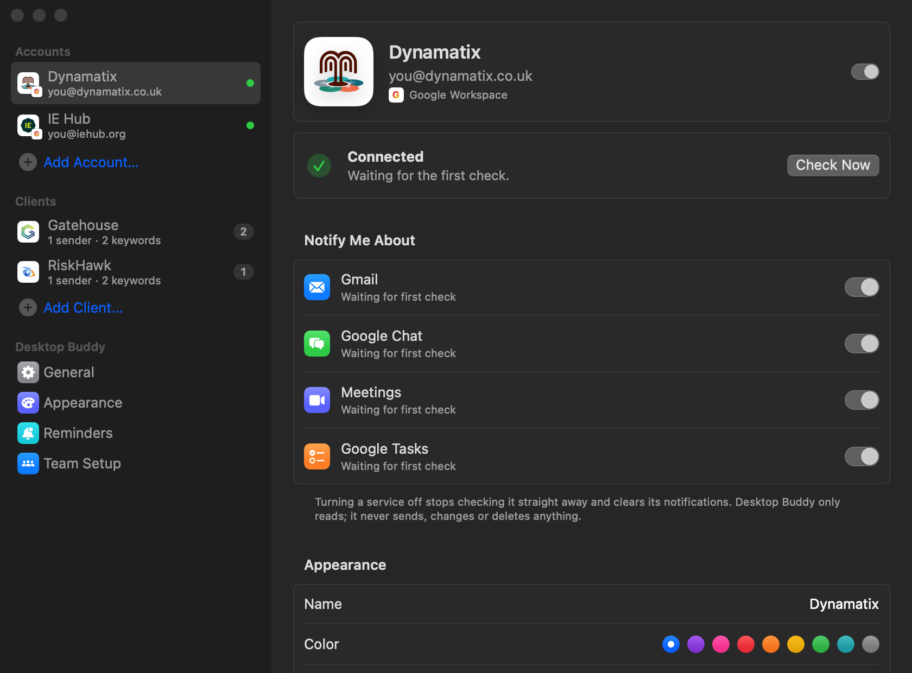
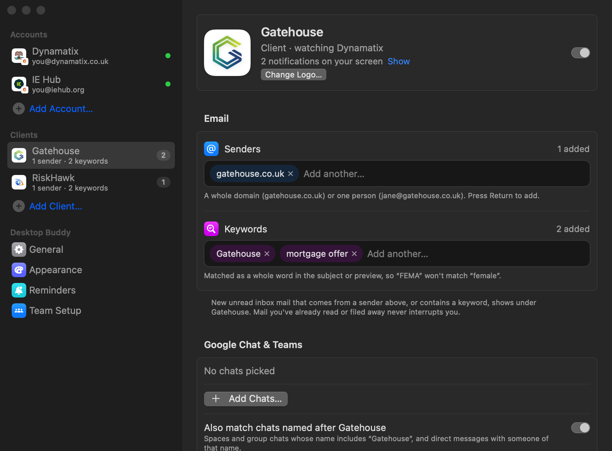

# Desktop Buddy

A native macOS menu bar app that puts a quiet notification on your desktop when something needs you in **Google Workspace** or **Microsoft 365**: new mail, chat messages, meetings about to start, tasks due today, and your own reminders.

- **Read-only.** It never sends, changes or deletes anything.
- **No servers, no AI.** Your Mac talks directly to Google and Microsoft. Nothing is sent anywhere else.
- **Several accounts at once**, plus **Clients**: group mail and chats from a client under their logo.

<p>
&nbsp;&nbsp;

</p>

---

## Contents

1. [Download and install](#1-download-and-install)
2. [Set up Google Cloud (Google Workspace accounts)](#2-set-up-google-cloud-google-workspace-accounts)
3. [Set up Microsoft Entra (Microsoft 365 accounts)](#3-set-up-microsoft-entra-microsoft-365-accounts)
4. [The team setup file (`team.json`)](#4-the-team-setup-file-teamjson)
5. [Add your accounts](#5-add-your-accounts)
6. [Clients](#6-clients)
7. [Privacy and data](#7-privacy-and-data)
8. [Troubleshooting](#8-troubleshooting)
9. [Build from source](#9-build-from-source)

**Getting started takes two steps:** [install the app](#1-download-and-install), then [sign in](#5-add-your-accounts). Google sign-in is built into the release, so there's nothing to set up.

Sections 2–4 are only for admins who build their own copy with their own Google or Microsoft project.

---

## 1. Download and install

**Requires:** macOS 14 Sonoma or later (Apple Silicon or Intel).

1. Open the repository's **[Releases](../../releases/latest)** page and download **`Desktop-Buddy.dmg`**. (The repository is private, so you need to be invited to it.)
2. Open the DMG and drag **Desktop Buddy** into **Applications**.
3. Open **Desktop Buddy** from Applications.

**First launch: "Apple could not verify…"**

The app isn't notarised by Apple yet, so macOS blocks it the first time.

1. Click **Done** on the warning.
2. Open **System Settings → Privacy & Security**.
3. Scroll down to the message about Desktop Buddy and click **Open Anyway**.
4. Enter your password and click **Open**.

You only do this once. Alternatively, run this in Terminal:

```bash
xattr -dr com.apple.quarantine "/Applications/Desktop Buddy.app"
```

When it's running, a **bell** appears in the menu bar and Settings opens with **Sign in with Google** and **Sign in with Microsoft**.

**Keychain prompt:** the first time the app reads your saved sign-ins, macOS asks for permission. Enter your Mac password and click **Always Allow**.

---

## 2. Set up Google Cloud (Google Workspace accounts)

> **Admins only, and only if you build your own copy.** The release already has Google sign-in built in. Everyone else skips to [step 5](#5-add-your-accounts).

### 2.1 Create a project

1. Go to **[console.cloud.google.com](https://console.cloud.google.com/)** and sign in with your company Google account.
2. Click the project picker at the top, then **New Project**.
3. Name it `Desktop Buddy`, then click **Create** and select it.

### 2.2 Enable the APIs

Open **[APIs & Services → Library](https://console.cloud.google.com/apis/library)** and enable each of these:

| API | Used for |
|---|---|
| **Gmail API** | Unread inbox mail |
| **Google Calendar API** | Meetings starting soon |
| **Google Chat API** | Chat messages |
| **Google Tasks API** | Tasks due today |
| **People API** | Colleagues' names in chats |

### 2.3 Configure the Google Chat app

The Chat API won't return messages until this is done.

1. Open **[Google Chat API → Configuration](https://console.cloud.google.com/apis/api/chat.googleapis.com/hangouts-chat)**.
2. Fill in:
   - **App name:** `Desktop Buddy`
   - **Avatar URL:** any image URL
   - **Description:** `Desktop notifications`
3. Turn off **Interactive features**, then click **Save**.

### 2.4 Set up the consent screen

1. Open **[Google Auth Platform → Branding](https://console.cloud.google.com/auth/branding)** and click **Get started**.
2. Enter the app name `Desktop Buddy` and a support email.
3. Choose the audience:
   - **Internal**: only people in your own Google Workspace domain. No Google review needed. **Recommended.**
   - **External**: needed for people in other domains (for example client workspaces).
     - While the app is unverified, up to 100 test users can sign in, and they see a warning.
     - Set **Publishing status** to **In production**. In "Testing", sign-ins expire every 7 days.
     - Each client's Workspace admin can remove the warning. In their Admin console they go to **Security → API controls → App access control** and mark your client ID as **Trusted**.
4. Under **Data Access**, add these scopes (all read-only):

```
openid
email
https://www.googleapis.com/auth/gmail.readonly
https://www.googleapis.com/auth/calendar.readonly
https://www.googleapis.com/auth/chat.spaces.readonly
https://www.googleapis.com/auth/chat.messages.readonly
https://www.googleapis.com/auth/tasks.readonly
https://www.googleapis.com/auth/directory.readonly
```

### 2.5 Create the OAuth client

1. Open **[Google Auth Platform → Clients](https://console.cloud.google.com/auth/clients)** and click **Create client**.
2. For **Application type**, choose **iOS**. Google uses this type for Mac apps too, and it has **no client secret**.
3. **Bundle ID:** `com.desktopbuddy.v2`. Leave **App Store ID**, **Team ID** and **Firebase App Check** empty.
4. Click **Create** and copy the **Client ID**. That's all you need for `team.json`.

> The client ID isn't a secret: it shows in the browser's address bar during every sign-in. With an iOS-type client there's no secret at all, so the app and this repository are safe to share. Sign-in is protected by PKCE, and Google sends the result back to the app through its own link (`com.googleusercontent.apps.…:/oauth2redirect`).
>
> A **Desktop app** client also works, but it comes with a secret, so builds that contain it should only be shared privately.

---

## 3. Set up Microsoft Entra (Microsoft 365 accounts)

> **Admins only.** Needed before people can use **Sign in with Microsoft**. Do it once, then build the client ID into the app ([step 4](#4-the-team-setup-file-teamjson)).

1. Open the **[Entra admin center → App registrations](https://entra.microsoft.com/#view/Microsoft_AAD_RegisteredApps/ApplicationsListBlade)** and click **New registration**.
2. **Name:** `Desktop Buddy`. For **Supported account types**, choose one:
   - **Single tenant**: your own organisation only, or
   - **Multitenant** (*Accounts in any organizational directory*): your organisation and client tenants.
3. Leave **Redirect URI** empty and click **Register**. Copy the **Application (client) ID**.
4. **Authentication → Add a platform → Mobile and desktop applications**:
   - Add the custom redirect URI `http://localhost`.
   - Set **Allow public client flows** to **Yes**, then click **Save**.
   - No client secret is needed.
5. **API permissions → Add a permission → Microsoft Graph → Delegated permissions**. Add:
   `User.Read`, `Mail.Read`, `Calendars.Read`, `Chat.Read`, `Tasks.Read`, `offline_access`.
6. If your organisation blocks user consent, click **Grant admin consent**.

---

## 4. The team setup file (`team.json`)

`team.json` holds the client IDs from steps 2 and 3. It's built into the app at build time ([step 9](#9-build-from-source)), so people only click **Sign In** and never see it. Installing it on a single Mac (below) is only needed for copies built without it.

### 4.1 Create it

**Option A: in the app (easiest)**
1. Hold **⌥ Option** while opening Settings (from the menu bar dropdown or the right-click menu), then open **Team Setup**. It's hidden from everyday users once sign-in is set up.
2. Enter the Google client ID and secret, and the Microsoft client ID.
3. Click **Export Setup File…** and save `team.json`.

**Option B: by hand.** Create a file named `team.json`:

```json
{
  "googleClientID": "1234567890-abc.apps.googleusercontent.com",
  "microsoftClientID": "00000000-0000-0000-0000-000000000000",
  "microsoftTenant": "organizations"
}
```

| Key | Value |
|---|---|
| `googleClientID` | From step 2.5. Leave it out if you don't use Google. |
| `googleClientSecret` | Only for a Desktop-type Google client. Leave it out for the recommended iOS-type client. |
| `microsoftClientID` | From step 3. Leave it out if you don't use Microsoft. |
| `microsoftTenant` | `organizations` (any work account), `common`, or your tenant ID for single-tenant apps |

### 4.2 Share it

With an iOS-type Google client and the Microsoft client, `team.json` holds only client IDs, which aren't secret. If it includes a `googleClientSecret` (Desktop-type client), share it privately and don't commit it. `team.json` is listed in `.gitignore` either way, so each team builds with its own.

### 4.3 Install it (each person)

**Option A:** hold **⌥ Option** while opening Settings, then **Team Setup → Import Setup File…** and pick `team.json`. (In a copy without sign-in set up, Team Setup shows without Option.)

**Option B:** copy it into the app's data folder:

```bash
cp ~/Downloads/team.json ~/Library/Application\ Support/DesktopBuddy/team.json
```

**Option C (admins):** build it into the app, so people don't install anything. See [step 9](#9-build-from-source).

With the iOS-type Google client, `team.json` has to be **built into the app** (option C): macOS only lets the app receive Google's sign-in link when it's registered at build time.

The app looks for `team.json` in this order:

1. `~/Library/Application Support/DesktopBuddy/team.json` (this Mac)
2. `Desktop Buddy.app/Contents/Resources/team.json` (built into the app)

Settings → Team Setup (hold ⌥ Option while opening Settings) shows which one is in use.

---

## 5. Add your accounts

1. In Settings, click **Sign in with Google** (or **Sign in with Microsoft**). To add another account later, use **Add Account…** in the sidebar.
2. Your browser opens. **Choose the account** you want to add and click **Allow**.
3. That's it. Desktop Buddy fills in the email and names the account from it: `you@dynamatix.co.uk` becomes **Dynamatix**, with its logo. You can rename it on the last screen.

Mail, chats, meetings and tasks all come with that one sign-in. Turn any of them off per account in Settings.



**Wrong browser profile?** While it waits, click **Copy Sign-in Link** and paste the link into the browser profile you use for that account. Adding an account that's already there is blocked, with a message.

---

## 6. Clients

A **Client** groups everything from one client under their logo, even if they never gave you an account:

| Rule | What it catches |
|---|---|
| **Senders** | Unread inbox mail from a domain (`client.com`) or an address (`jo@client.com`) |
| **Keywords** | Unread inbox mail with that whole word in the subject or preview |
| **Chats** | Google Chat spaces or Teams chats you pick from a list |
| **Name match** | Chats whose name contains the client's name |
| **Look in** | All your accounts, or only selected ones |

If a rule can't work (for example Chat is off for that account), the client page shows **Needs Attention** with a one-click fix.



---

## 7. Privacy and data

| | |
|---|---|
| **Permissions** | Read-only. Google: Gmail, Calendar, Chat, Tasks, Directory. Microsoft: Mail, Calendars, Chat, Tasks. |
| **Sign-in** | OAuth 2.0 with PKCE in your own browser. The app never sees your password. |
| **Tokens** | macOS Keychain only |
| **Cached data** | `~/Library/Application Support/DesktopBuddy/`: settings and the notifications currently on screen (sender, subject, short preview) |
| **Log** | `status.log` in the same folder: counts and errors only, never message content. Capped at 1 MB. |
| **Network** | Google and Microsoft APIs over HTTPS, plus one daily check of this repository's latest release on GitHub (no account data sent; can be turned off). No analytics, no AI, no other servers. |
| **Dependencies** | None. Apple frameworks only. |

**Updates:** once a day the app checks this repository for a newer release. If there is one, the menu bar popover shows **"Desktop Buddy x.y is available"** with a **Download** button. Open the DMG and drag Desktop Buddy into Applications, choosing **Replace**. Your accounts and settings stay. You can also click **Check for Updates…** (right-click the menu bar icon), or turn automatic checks off in **Settings → General → Updates**.

**To uninstall:**
1. Quit the app and delete it from Applications.
2. Delete `~/Library/Application Support/DesktopBuddy/`.
3. In **Keychain Access**, delete `com.desktopbuddy.google`.

---

## 8. Troubleshooting

| Problem | Fix |
|---|---|
| "Apple could not verify…" | See [first launch](#1-download-and-install) |
| "Sign-in isn't set up in this copy yet" | This copy was built without `team.json`. Use the release DMG, or import the setup file ([step 4.3](#43-install-it-each-person)). |
| "Access blocked: app not verified" or `org_internal` | The consent screen is Internal and you're signing in from another domain. Use External, add yourself as a test user, or ask that domain's admin to trust the app. |
| Signed out every 7 days | Consent screen publishing status is **Testing**. Set it to **In production**. |
| "Gmail API has not been used in project…" | Enable that API (step 2.2). The account page shows a **Fix…** link. |
| Chat shows nothing | Do step 2.3 (Chat app configuration) |
| "Sign-in Expired" | Click **Sign In Again** on the account |
| Keychain asks again after an update | Click **Always Allow**. Builds that aren't signed with a Developer ID ask once per new version. |

---

## 9. Build from source

Requires the Xcode Command Line Tools (`xcode-select --install`).

```bash
gh repo clone abhisheksaggam-design/desktop-buddy
```
```bash
cd desktop-buddy && ./build-app.sh --install
```

`build-app.sh` compiles the app and runs the built-in self-test. It stops if any test fails, then packages `dist/Desktop Buddy.app`.

| Command | Result |
|---|---|
| `./build-app.sh` | Build only |
| `./build-app.sh --install` | Build, copy to /Applications, launch |
| `./build-app.sh --share` | Build `dist/Desktop Buddy.dmg` and `.zip` to share |

**Bundling `team.json`:** put `team.json` in the project folder before `--share`. It's then built into the app, so people only click **Sign In**, and the build registers the app's Google sign-in link. With an iOS-type Google client the DMG contains only client IDs, so it's safe to share. If you use a Desktop-type client with a secret, share that DMG privately.

**Signing for distribution:** with an Apple Developer ID, sign and notarise the DMG so it opens without warnings:

```bash
SIGN_ID="Developer ID Application: Your Company (TEAMID)" ./build-app.sh --share
```
```bash
xcrun notarytool submit "dist/Desktop Buddy.dmg" --keychain-profile notary --wait
```
```bash
xcrun stapler staple "dist/Desktop Buddy.dmg"
```

### Project layout

| Path | Role |
|---|---|
| `Sources/DesktopBuddy/App.swift` | Menu bar item, windows, run modes |
| `…/OAuth.swift`, `SignInCenter.swift` | Google and Microsoft sign-in (PKCE, loopback), Keychain tokens |
| `…/TeamConfig.swift` | Reads `team.json` |
| `…/GoogleSources.swift` | Gmail, Google Chat, Calendar, Tasks |
| `…/MicrosoftSources.swift` | Outlook, Teams chats, Calendar, To Do (Microsoft Graph) |
| `…/Poller.swift` | Polling, reminders, status log |
| `…/AppState.swift`, `Models.swift`, `Persistence.swift` | State, data model, local storage |
| `…/Clients.swift`, `ClientHealth.swift`, `ClientSettings.swift` | Client rules, health checks, client pages |
| `…/SettingsWindow.swift`, `Overlay.swift`, `MenuBarPopover.swift` | Interface |
| `…/Updates.swift` | Daily check for a newer GitHub release |
| `…/SelfTest.swift` | Built-in scenario tests (`--selftest`) |
| `Resources/` | App icon and bundled logos |
| `docs/` | Screenshots |

### Publishing a new version

1. Raise `CFBundleShortVersionString` in `build-app.sh` (for example `2.1` → `2.2`) and `CFBundleVersion` by one.
2. Build the DMG with `team.json` in the folder: `./build-app.sh --share`.
3. Create a GitHub release tagged `v2.2` and attach the DMG named **`Desktop-Buddy.dmg`**.

Within a day, everyone's app shows the update. The tag must be higher than the version people have, and releases marked as pre-release are ignored.
